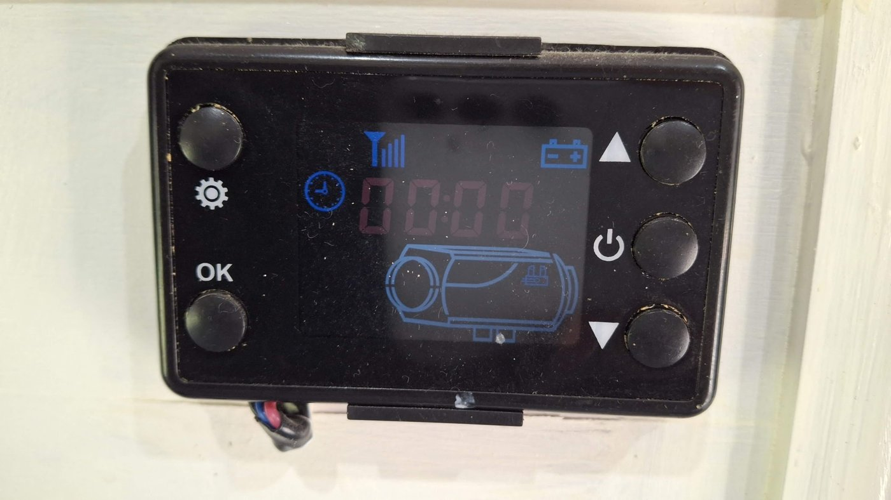
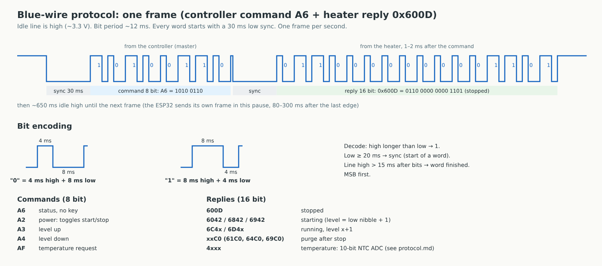

# VEVOR diesel heater → ESPHome / Home Assistant (blue-wire PWM protocol)

An ESP32 sits on the **blue data wire** between a Chinese diesel air heater and its LCD controller
and lets Home Assistant start/stop the heater, set the power level 1–6, read its state and internal temperature,
and run a simple thermostat (Comfort / Antifreeze) from any cabin temperature sensor.
The original controller stays connected and keeps working.

**Works with VEVOR diesel air heaters that have this LCD controller** (see the photo: 5 buttons, gear / OK on the left,
up / power / down on the right, 433 MHz icon, 3-wire cable red / blue / black, no Bluetooth). Many other Chinese
heaters ship with the same controller and will probably work too.

> Tested on one heater. This is **not** the Afterburner / "blue wire UART" protocol; heaters with other controllers
> may use different codes. Use at your own risk: a diesel heater is a fuel-burning device.
> Not affiliated with VEVOR; the name is used only to describe compatibility.



*The VEVOR controller this was tested with (red/blue/black cable at the bottom left).*

## What's inside

| Path | What it is |
|---|---|
| `esphome/diesel-heater.yaml` | ESPHome firmware (ESP32 DevKit, esp-idf). Receive + transmit on GPIO16 |
| `homeassistant/packages/diesel_heater.yaml` | HA package: thermostat (Manual / Comfort / Antifreeze, ±2 °C hysteresis, always level 1) |
| `homeassistant/dashboards/heater-dashboard.yaml` | One dashboard view (button-card): state, Start/Stop, clickable level bars, thermostat |
| `docs/protocol.md` | The protocol as decoded from logic captures (timings, commands, replies, temperature formula) |
| `docs/controller.jpg` | photo of the tested controller |
| `docs/protocol-timing.svg` / `.png` | Timing diagram of one frame and the bit encoding |
| `docs/diesel-heater-wiring.svg` / `.png` | Wiring diagram and its generator script |


## Protocol at a glance



- One wire, idle high (~3.3 V on this heater). PWM bits of ~12 ms: `0` = 4 ms high + 8 ms low, `1` = 8 ms high + 4 ms low, MSB first.
- Every word starts with a 30 ms low sync. Once per second the controller sends an 8-bit command and the heater answers
  with a 16-bit word 1–2 ms later.
- Commands: `A6` status, `A2` power (toggles start/stop, ignored during purge), `A3` level up, `A4` level down, `AF` temperature.
- Replies: `600D` stopped, `6042`/`6842`/`6942` starting, `6C4x`/`6D4x` running at level x+1, `xxC0` purge,
  `4xxx` internal temperature (10-bit ADC of an NTC thermistor: `T[K] = 4055.85 / (ln(1023/raw − 1) + 12.0813)`).
- The ESP32 transmits only in the pause between controller frames (80–300 ms after the last edge) and verifies every
  command by the following replies.

Full details: [docs/protocol.md](docs/protocol.md).

## Wiring (short)

- Controller **blue** wire → **1 kΩ resistor** → ESP32 **GPIO16**. No divider: the line is ~3.3 V logic on this heater.
- Controller **black** → ESP32 **GND**.
- Controller **red** (5 V) → **not connected** (the controller can't supply an ESP32 with Wi-Fi; its screen flickers).
- Power the ESP32 from USB, or permanently: 12 V → **2 A fuse** → Mini360 buck set to **5.0 V** (set it before connecting!) → VIN.

See `docs/diesel-heater-wiring.png`.

## Install

1. **Firmware.** Copy `esphome/diesel-heater.yaml` into ESPHome Builder. Add `wifi_ssid`, `wifi_password` and
   `api_key_heater` (32 bytes, base64: `openssl rand -base64 32`) to your ESPHome `secrets.yaml`. Install.
2. **Package.** Enable packages in `configuration.yaml`:
   ```yaml
   homeassistant:
     packages: !include_dir_named packages
   ```
   copy `homeassistant/packages/diesel_heater.yaml` to `config/packages/`, replace `sensor.cabin_temperature`
   with your cabin temperature sensor, restart Home Assistant.
3. **Dashboard.** Install `button-card` from HACS. Create a dashboard, open the Raw configuration editor and paste
   `homeassistant/dashboards/heater-dashboard.yaml` (again replace `sensor.cabin_temperature`).

Check the entity ids after flashing (Settings → Devices → Diesel Heater). The files expect ids like
`switch.heater_power_diesel_heater`; if yours differ, search & replace.

## Entities (ESPHome device "Diesel Heater")

| Entity | Meaning |
|---|---|
| `switch.heater_power_diesel_heater` | ON = starting or running. Turning on is refused during purge |
| `number.heater_level_diesel_heater` | Power level 1–6 (sends up/down steps and verifies the reply) |
| `sensor.run_state_diesel_heater` | `Stopped` / `Starting` / `Running` / `Purge` |
| `sensor.heater_temperature_diesel_heater` | Internal heater temperature, °C |
| `binary_sensor.heater_active_diesel_heater`, `binary_sensor.heater_link_diesel_heater` | Active; heater replied in the last 15 s |
| `sensor.heater_command_result_diesel_heater` | Result of the last command (text) |
| diagnostics | raw temperature, status word, word counters, Wi-Fi, uptime |

The package and the dashboard compare against these state strings; if you rename them in the firmware, rename them there too.

## Thermostat (package)

- Modes: `Manual` (the thermostat does nothing), `Comfort`, `Antifreeze`, each with its own setpoint.
- Start at setpoint − 2 °C, stop at setpoint + 2 °C, always at power level 1.
- A manual Stop (dashboard or the controller's button) in any mode switches the mode to manual.
- Runs in Home Assistant: no HA, no antifreeze.

## License

MIT, see `LICENSE`. Protocol notes are original work from captures of one heater.
