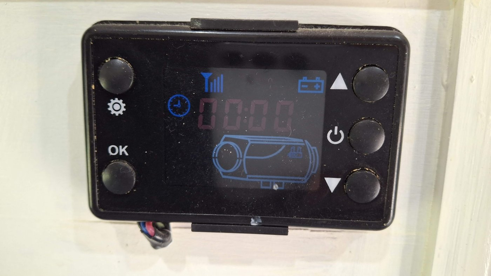
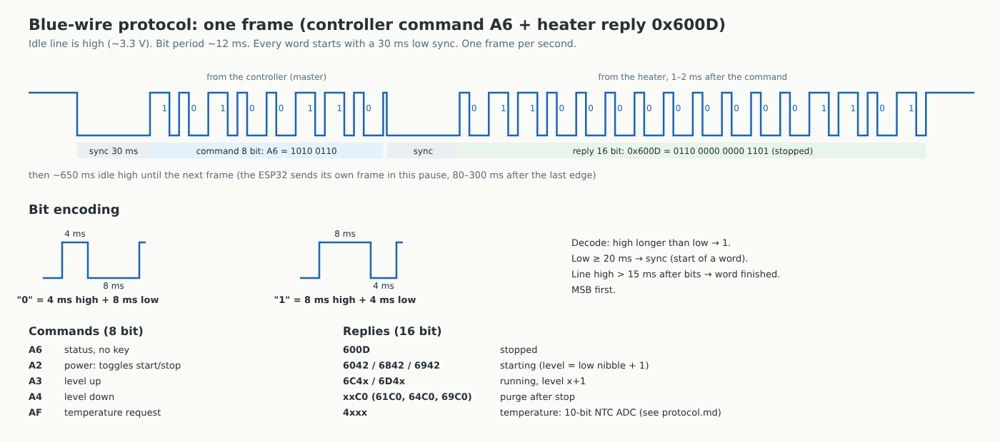
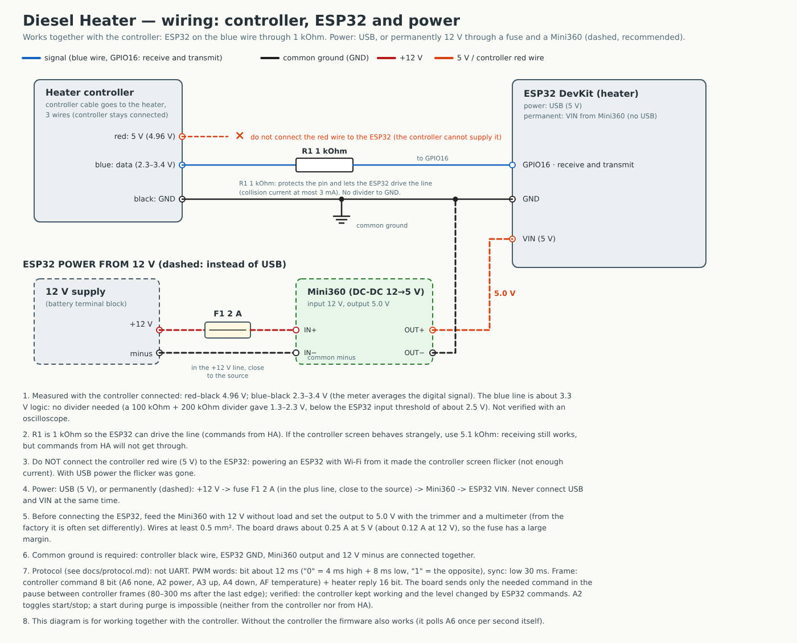

# VEVOR diesel heater → ESPHome / Home Assistant (blue-wire PWM protocol)

An ESP32 sits on the **blue data wire** between a Chinese diesel air heater and its LCD controller
and lets Home Assistant start/stop the heater, set the power level 1–6, read its state and internal temperature,
and run a simple thermostat (Comfort / Antifreeze) from any cabin temperature sensor.
The original controller stays connected and keeps working.

**Works with VEVOR diesel air heaters that have this LCD controller** (see the photo: 5 buttons, gear / OK on the left,
up / power / down on the right, 433 MHz icon, 3-wire cable red / blue / black, no Bluetooth). Many other Chinese
heaters ship with the same controller and will probably work too.

> Tested on one heater. This is **not** the Afterburner / "blue wire UART" protocol; heaters with other controllers
> may use different codes. Use at your own risk: a diesel heater is a fuel-burning device.
> Not affiliated with VEVOR; the name is used only to describe compatibility.



*The VEVOR controller this was tested with (red/blue/black cable at the bottom left).*

## What's inside

| Path | What it is |
|---|---|
| `esphome/diesel-heater.yaml` | ESPHome firmware as a package (ESP32 DevKit, esp-idf). Receive + transmit on GPIO16. You do not copy it |
| `esphome/example.yaml` | The short file you put into ESPHome Device Builder: it pulls the firmware from GitHub |
| `homeassistant/packages/diesel_heater.yaml` | HA package: thermostat (Manual / Comfort / Antifreeze, ±2 °C hysteresis, always level 1) |
| `homeassistant/dashboards/heater-dashboard.yaml` | One dashboard view (button-card): state, Start/Stop, clickable level bars, thermostat |
| `docs/protocol.md` | The protocol as decoded from logic captures (timings, commands, replies, temperature formula) |
| `docs/controller.jpg` | photo of the tested controller |
| `docs/protocol-timing.svg` / `.png` | Timing diagram of one frame and the bit encoding |
| `docs/diesel-heater-wiring.svg` / `.png` | Wiring diagram and its generator script |
| `examples/python/bluewire.py` | Reference encoder/decoder in plain Python: decodes a logic-analyzer capture, has a self-test |
| `examples/arduino/bluewire_monitor/` | Minimal Arduino (ESP32) sketch without ESPHome: prints the traffic, sends single commands |

## What you need

- A heater with the 5-button LCD controller shown above (3-wire cable: red / blue / black).
- ESP32 DevKit board (`esp32dev`, 30 or 38 pins) and a USB cable for the first flash.
- One **1 kΩ** resistor and two thin wires (blue line and ground).
- For permanent power instead of USB: Mini360 (or another 12 V → 5 V buck converter) and a **2 A** inline fuse.
- Home Assistant with the ESPHome Device Builder add-on, and HACS `button-card` for the dashboard.
- A multimeter.

## Afterburner? Which "blue wire" do you have

Most people searching for Chinese diesel heater control find **Afterburner** (Ray Jones' open-source controller,
see e.g. [github.com/NiklasVoigt/Afterburner](https://github.com/NiklasVoigt/Afterburner)). Afterburner speaks the
**"blue wire" UART protocol**: 25000 baud, 24-byte frames with a CRC, sent by the classic rotary-knob / LCD controllers.

This project is for a **different blue-wire protocol** used by the 5-button LCD controller (VEVOR and look-alikes):
slow **PWM bits of ~12 ms**, an 8-bit command and a 16-bit reply once per second, no UART at all.
On this heater an Afterburner-style UART decoder at 25000 baud only receives zeros.

How to tell them apart:

| | Afterburner / UART blue wire | This project (PWM blue wire) |
|---|---|---|
| Controller | rotary knob or older LCD controllers | 5-button LCD: gear / OK left, up / power / down right, 433 MHz icon |
| Signal | UART 25000 baud, 24-byte frames, CRC16 | PWM, bit ≈ 12 ms, 30 ms low sync, 8 + 16 bit words |
| Data | voltages, fan RPM, pump Hz, glow plug, temperatures | state, power level 1–6, internal temperature |
| What to use | Afterburner (or an ESPHome UART port of it) | this repository |

If you are not sure, flash this firmware and watch the log: with the PWM protocol you will see
`state: word 0x600D = Stopped` (or similar) within a few seconds.
No Afterburner code is used here; its sources were only read to compare the protocols.

## Protocol at a glance



- One wire, idle high (~3.3 V on this heater). PWM bits of ~12 ms: `0` = 4 ms high + 8 ms low, `1` = 8 ms high + 4 ms low, MSB first.
- Every word starts with a 30 ms low sync. Once per second the controller sends an 8-bit command and the heater answers
  with a 16-bit word 1–2 ms later.
- Commands: `A6` status, `A2` power (toggles start/stop, ignored during purge), `A3` level up, `A4` level down, `AF` temperature.
- Replies: `600D` stopped, `6042`/`6842`/`6942` starting, `6C4x`/`6D4x` running at level x+1, `xxC0` purge,
  `4xxx` internal temperature (10-bit ADC of an NTC thermistor: `T[K] = 4055.85 / (ln(1023/raw − 1) + 12.0813)`).
- The ESP32 transmits only in the pause between controller frames (80–250 ms after the last edge) and verifies every
  command by the following replies.

Full details: [docs/protocol.md](docs/protocol.md).

## Wiring



**Measure first.** With the heater powered and the controller connected, measure with a multimeter between the controller wires:
red–black should be about 5 V, blue–black should jump around 2–3.6 V (the meter averages the data signal).
If blue–black reads close to 5 V, your line uses 5 V logic: do not connect it to the ESP32 as shown here.

**Tap the cable, do not cut it.** The controller stays connected to the heater exactly as before. The ESP32 is added
*in parallel* on the 3-wire cable between the controller and the heater, anywhere along it (behind the controller is usually
the easiest place): strip a few millimetres of insulation and solder a thin wire on, or use a T-tap / Wago splice.

- Controller **blue** wire → **1 kΩ resistor** → ESP32 **GPIO16**. No divider: the line is ~3.3 V logic on this heater.
- Controller **black** → ESP32 **GND**.
- Controller **red** (5 V) → **not connected** (the controller can't supply an ESP32 with Wi-Fi; its screen flickers).
- Power the ESP32 from USB, or permanently: 12 V → **2 A fuse** → Mini360 buck set to **5.0 V** (set it before connecting!) → VIN.
  Never connect USB and VIN at the same time.

## Install

Requirements: Home Assistant **2024.10 or newer** (the package uses the `triggers:` / `actions:` syntax) with the
**ESPHome Device Builder** add-on. Tested with Home Assistant 2026.11 and ESPHome 2026.10.

### 1. Firmware

You do not copy the firmware. You keep a short file of your own, and ESPHome downloads the firmware from this repository when it builds.

1. In ESPHome Device Builder click **Secrets** and add three lines (skip the Wi-Fi ones if you already have them):
   ```yaml
   wifi_ssid: "your Wi-Fi name"
   wifi_password: "your Wi-Fi password"
   api_key_heater: "paste a 32-byte base64 key here"
   ```
   Generate the key with `openssl rand -base64 32`, or copy the one ESPHome Device Builder generates for a new device.
2. **New device** → name it `diesel-heater` → skip the installation step. Open **Edit** and replace the whole text with
   [`esphome/example.yaml`](esphome/example.yaml):
   ```yaml
   substitutions:
     name: diesel-heater
     friendly_name: "Diesel Heater"
     # heater_gpio: "16"          # uncomment to use another pin for the blue wire

   packages:
     heater: github://sashko2000/diesel-heater-esphome/esphome/diesel-heater.yaml@v1.1.1

   api:
     encryption:
       key: !secret api_key_heater

   ota:
     - id: !extend ota_esphome
       password: !secret api_key_heater

   wifi:
     ssid: !secret wifi_ssid
     password: !secret wifi_password
   ```
3. **Install.** The first time the board must be flashed over USB: choose *Plug into this computer* and follow the prompts.
   All later updates can go *Wirelessly*.
4. In Home Assistant open **Settings → Devices & services**. The board shows up as a discovered ESPHome device:
   press **Configure** and enter the same `api_key_heater` value when asked for the encryption key.

**Updating.** When a new version is released, change the version after `@` in your file and press Install.
`@v1.1.1` pins a tested release; `@main` follows the latest commit.

**Without the download.** Save `esphome/diesel-heater.yaml` next to your file in the ESPHome folder and use
`heater: !include diesel-heater.yaml` instead of the `github://` line.

### 2. Check before you press anything

Wire the board (see above), power the heater, then open **Logs** of the device in ESPHome Device Builder. Within a few seconds you should see:

```
[heater] blue wire receiver started (GPIO16)
[heater] command on the line: 0xA6
[heater] state: word 0x600D = Stopped, level 0
```

In Home Assistant *Heater Link* must be **Connected** and *Run State* must be **Stopped**. With the controller connected the
board only listens until you send a command from Home Assistant. If you do not see these lines, go to [Troubleshooting](#troubleshooting)
and do not try to start the heater from Home Assistant yet.

Then test once by hand: turn *Heater Power* on, watch the controller screen and *Heater Command Result*, change *Heater Level*, turn it off.
Stopping starts a purge of several minutes: do not cut the heater's power during it.

### 3. Package (thermostat)

Enable packages in `configuration.yaml`:
```yaml
homeassistant:
  packages: !include_dir_named packages
```
Copy `homeassistant/packages/diesel_heater.yaml` to `config/packages/`, replace `sensor.cabin_temperature`
with your cabin temperature sensor, then **restart Home Assistant** (a reload is not enough for new helpers).

### 4. Dashboard

Install `button-card` from HACS. Create a dashboard, open the Raw configuration editor and paste
`homeassistant/dashboards/heater-dashboard.yaml` (again replace `sensor.cabin_temperature`).

### Entity ids

Check the entity ids after flashing (Settings → Devices → Diesel Heater). The files expect ids like
`switch.heater_power_diesel_heater`; if yours differ (for example `switch.diesel_heater_heater_power`),
search & replace them in the package and in the dashboard.

## Entities (ESPHome device "Diesel Heater")

| Entity | Meaning |
|---|---|
| `switch.heater_power_diesel_heater` | ON = starting or running. Turning on is refused during purge |
| `number.heater_level_diesel_heater` | Power level 1–6 (sends up/down steps and verifies the reply) |
| `sensor.run_state_diesel_heater` | `Stopped` / `Starting` / `Running` / `Purge` |
| `sensor.heater_temperature_diesel_heater` | Internal heater temperature, °C |
| `binary_sensor.heater_active_diesel_heater`, `binary_sensor.heater_link_diesel_heater` | Active; heater replied in the last 15 s |
| `sensor.heater_command_result_diesel_heater` | Result of the last command (text) |
| diagnostics | raw temperature, status word, word counters, Wi-Fi, uptime |

The package and the dashboard compare against these state strings; if you rename them in the firmware, rename them there too.

## Thermostat (package)

- Modes: `Manual` (the thermostat does nothing), `Comfort`, `Antifreeze`, each with its own setpoint.
- Start at setpoint − 2 °C, stop at setpoint + 2 °C, always at power level 1.
- A manual Stop (dashboard or the controller's button) in any mode switches the mode to manual.
- Runs in Home Assistant: no HA, no antifreeze.

## For developers: without Home Assistant

If you want to build your own controller, or just look at the protocol, you do not need Home Assistant or ESPHome.

- **`docs/protocol.md`** is the specification: timings, commands, replies, the temperature formula.
- **`examples/python/bluewire.py`** is a reference implementation in plain Python 3 (no dependencies):
  ```
  python examples/python/bluewire.py --selftest      # encodes frames, adds jitter, decodes them again
  python examples/python/bluewire.py --demo          # the exact HIGH/LOW sequence of one command frame
  python examples/python/bluewire.py capture.csv     # decodes a logic-analyzer export (time in s, level 0/1)
  ```
  Record the blue wire with any logic analyzer (1 kHz is not enough, use 20 kHz or more), export to CSV and feed it in.
  `decode_edges()`, `encode_frame()`, `transmit_plan()` and `parse_reply()` are small enough to port to any language.
- **`examples/arduino/bluewire_monitor/`** is a minimal Arduino sketch for an ESP32 (same wiring as above): it prints every
  change on the line to the serial monitor and sends single commands typed there (`t` temperature, `+` / `-` level,
  `P` power toggle). It does not verify or retry commands; the ESPHome firmware shows how to do that.
  The sketch was tested on a computer against a model of the line, not yet on a board.

Things that are easy to get wrong:

- Decide a bit by comparing the high time with the low time, not by absolute thresholds: the controller's clock jitters.
- `A2` **toggles**. Never send it blindly: read the state first, and check the reply afterwards.
- With the original controller connected, transmit only in the pause between its frames (80–250 ms after the last edge)
  and release the line right after your last bit, or you will collide with the controller or with the heater's reply.
- The heater ignores `A2` during the purge after a stop, and answers `AF` only while it is running.

## Troubleshooting

| What you see | Likely cause |
|---|---|
| No `command on the line` / `state: word` lines, *Words OK* stays 0 | No common ground, the tap is on the wrong wire, the resistor is not connected, or the heater has no 12 V (the controller is powered by the heater). If the wiring is right, your controller probably speaks the UART "blue wire" protocol: see the Afterburner table above |
| *Words Bad* grows by more than a few per minute | Noise or a poor contact on the blue wire or on ground |
| *Heater Link* is off | No heater reply for 15 s: check the wiring and the heater's power |
| Controller screen flickers or resets | The ESP32 is powered from the controller's red wire. Disconnect it and power the board from USB or the buck converter |
| `Start refused: purge in progress` | Normal: this heater cannot be started during the purge, wait until *Run State* is `Stopped` |
| A command needs a second attempt | Normal: a few frames get lost, the board verifies every command by the reply and retries up to 3 times |
| Log warning `... took a long time for an operation` | Normal: sending one command blocks the loop for about 130 ms |
| Package or dashboard shows "entity not found" | Entity ids differ, see [Entity ids](#entity-ids) |

## Changelog

**1.1.1** (2026-11-14)
- The state is reset to `Unknown` after 30 s without replies instead of 15 s: at the start of the purge the replies can be unreadable
  for about 20 s, and *Run State* flickered to `Unknown`. *Heater Link* still turns off after 15 s.

**1.1.0** (2026-11-14)
- Firmware is now an ESPHome package: your file holds only names, Wi-Fi and keys; the blue-wire pin is a substitution (`heater_gpio`).
- `0x600C` (a single-frame variant of `0x600D` while idle) is treated as *Stopped*; *Run State* no longer flickers to `Unknown`.
- A Start or Stop request expires after 30 s and a level request after 60 s. Before, a Start pressed while the heater was unpowered
  could fire when its power came back.
- No replies for 15 s (30 s since 1.1.1): the state becomes `Unknown` instead of keeping the last value.
- *Heater Temperature* becomes unknown after a stop instead of keeping the last value.
- Transmit window narrowed to 80–250 ms after the last edge; after power-up the board listens for 1.5 s before it sends anything.

**1.0.0** (2026-11-03): first release.

## Support

If this project saved you some time, you can buy me a coffee:

[](https://buymeacoffee.com/sashko2000)

## License

MIT, see `LICENSE`. Protocol notes are original work from captures of one heater.
