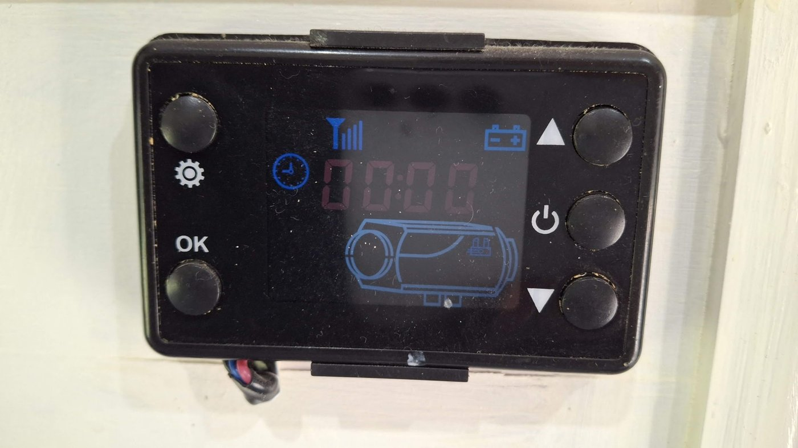
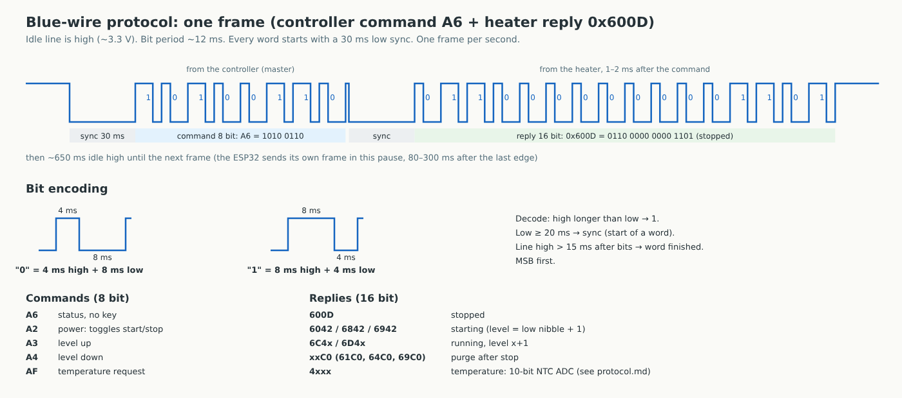

# Дизельный обогреватель VEVOR → ESPHome / Home Assistant (протокол синего провода)

[English version](README.md)

ESP32 подключается к **синему проводу** между китайским дизельным обогревателем и его пультом с ЖК-экраном.
Home Assistant может запускать и останавливать обогреватель, ставить уровень 1–6, видеть состояние и температуру
внутри обогревателя, а пакет добавляет термостат (Комфорт / Антизамерзание) по любому датчику температуры салона.
Родной пульт остаётся подключённым и работает как раньше.

**Подходит к дизельным обогревателям VEVOR с таким пультом** (см. фото: 5 кнопок, слева шестерёнка и OK, справа
вверх / питание / вниз, значок 433 МГц, кабель из 3 проводов красный / синий / чёрный, без Bluetooth). Такой же пульт
ставят на многие другие китайские обогреватели, с ними, скорее всего, тоже будет работать.

> Проверено на одном обогревателе. Это **не** протокол Afterburner (UART 25000 бод); у обогревателей с другими пультами
> коды могут отличаться. Всё на свой риск: обогреватель сжигает топливо.
> Проект не связан с VEVOR, название указано только для описания совместимости.



*Пульт VEVOR, с которым всё проверено (кабель красный/синий/чёрный слева внизу).*

## Что в репозитории

| Путь | Что это |
|---|---|
| `esphome/diesel-heater.yaml` | прошивка ESPHome (ESP32 DevKit, esp-idf), приём и передача на GPIO16 |
| `homeassistant/packages/diesel_heater.yaml` | пакет HA: термостат (Ручной / Комфорт / Антизамерзание, гистерезис ±2 °C, всегда уровень 1) |
| `homeassistant/dashboards/heater-dashboard.yaml` | вкладка дашборда (button-card): состояние, Пуск/Стоп, полоски уровня, термостат |
| `docs/protocol.md` | протокол по записям сигнала (тайминги, команды, ответы, формула температуры), на английском |
| `docs/controller.jpg` | фото пульта, с которым всё проверено |
| `docs/protocol-timing.svg` / `.png` | временная диаграмма одного кадра и кодирования бит |
| `docs/diesel-heater-wiring.svg` / `.png` | схема подключения и скрипт, который её рисует |

## Протокол коротко



- Один провод, в покое высокий уровень (около 3,3 В). Биты ШИМ около 12 мс: `0` = 4 мс высокий + 8 мс низкий,
  `1` = 8 мс высокий + 4 мс низкий, старший бит первым.
- Каждое слово начинается с синхроимпульса: низкий уровень 30 мс. Раз в секунду пульт шлёт команду (8 бит),
  обогреватель через 1–2 мс отвечает словом из 16 бит.
- Команды: `A6` статус, `A2` питание (переключает пуск/остановку, в продувке игнорируется), `A3` вверх, `A4` вниз, `AF` температура.
- Ответы: `600D` остановлен, `6042`/`6842`/`6942` запуск, `6C4x`/`6D4x` работает на уровне x+1, `xxC0` продувка,
  `4xxx` температура внутри (10-битный АЦП с NTC-термистором: `T[K] = 4055,85 / (ln(1023/сырое − 1) + 12,0813)`).
- ESP32 передаёт только в паузе между кадрами пульта (80–300 мс после последнего фронта) и проверяет каждую команду по ответам.

Подробно (на английском): [docs/protocol.md](docs/protocol.md).

## Подключение

- **Синий** провод пульта → **резистор 1 кОм** → **GPIO16** ESP32. Делитель не нужен: на этом обогревателе логика около 3,3 В.
- **Чёрный** → **GND** ESP32.
- **Красный** (5 В) **не подключать**: пульт не тянет ESP32 с Wi-Fi, экран мигает.
- Питание ESP32 по USB или постоянно: 12 В → **предохранитель 2 А** → Mini360, выставленный на **5,0 В** (выставить до подключения!) → VIN.

Схема: `docs/diesel-heater-wiring.png`.

## Установка

1. **Прошивка.** Скопируйте `esphome/diesel-heater.yaml` в ESPHome Builder, добавьте в `secrets.yaml` ESPHome
   `wifi_ssid`, `wifi_password` и `api_key_heater` (32 байта в base64: `openssl rand -base64 32`), прошейте.
2. **Пакет.** Включите пакеты в `configuration.yaml`:
   ```yaml
   homeassistant:
     packages: !include_dir_named packages
   ```
   положите `homeassistant/packages/diesel_heater.yaml` в `config/packages/`, замените `sensor.cabin_temperature`
   на свой датчик температуры салона, полностью перезапустите HA.
3. **Дашборд.** Поставьте `button-card` из HACS, создайте дашборд, откройте Raw configuration editor и вставьте
   `homeassistant/dashboards/heater-dashboard.yaml` (там тоже замените `sensor.cabin_temperature`).

После прошивки проверьте id сущностей (Настройки → Устройства → Diesel Heater). Файлы рассчитаны на id вида
`switch.heater_power_diesel_heater`; если у вас другие, сделайте поиск и замену.

## Сущности и термостат

Список сущностей — в [README.md](README.md). Коротко: питание, уровень 1–6, состояние
(`Stopped` / `Starting` / `Running` / `Purge`), температура внутри обогревателя в °C, связь, результат последней команды.
Все тексты в прошивке, пакете и дашборде на английском.

Термостат: режимы `Manual` (ручной), `Comfort` (комфорт), `Antifreeze` (антизамерзание). Пуск при уставке минус 2 °C,
остановка при уставке плюс 2 °C, всегда уровень 1; ручной «Stop» в любом режиме переключает на `Manual`.
Термостат работает внутри HA.

## Лицензия

MIT, см. `LICENSE`.
